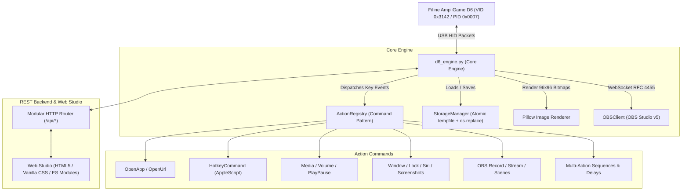

# Fifine AmpliGame D6 (StreamDock 293S) Controller & Web Studio Pro 🎮⚡

[](https://www.python.org/)
[](https://opensource.org/licenses/MIT)
[](https://apple.com)
[](https://fifinemicrophone.com)
[-brightgreen.svg)]()
[](https://obsproject.com)

> **Autonomous high-performance USB/HID driver, decoupled Command Pattern automation engine, and modern Web Studio for the Fifine AmpliGame D6 (15 LCD Keys Stream Deck). Zero dependency on the proprietary `fifine Control Deck.app`.**

---

## 📖 English / Português Summary

* **English:** A complete, reverse-engineered, open-source replacement for the fragile Fifine Control Deck software. Provides direct USB HID hardware control, an atomic configuration database, 80+ action handlers, native OBS Studio v5 integration, and a responsive Web Studio interface.
* **Português:** Driver autônomo e estúdio web de código aberto para o Fifine AmpliGame D6. Elimina 100% a dependência do app oficial da Fifine, corrige falhas de perda de perfil (`manifest.json`), oferece persistência atômica e controle total via USB HID.

---

## 🌟 Why This Project Exists (The Problem We Solved)

The **Fifine AmpliGame D6** is a budget-friendly 15-key LCD macro pad (featuring a 3x5 physical key layout with individual color screens). However, its bundled software (**fifine Control Deck.app**) suffers from critical flaws:

1. **Manifest Resets & Configuration Loss:** Any crash or abrupt Mac sleep event corrupts `manifest.json`, frequently wiping out all configured keys and pages.
2. **High Resource Consumption & Freezes:** The Electron/Qt-based vendor client often consumes excessive RAM and locks up during wake-from-sleep events.
3. **Limited Extensibility:** Closed plugin system that makes custom scripting, AppleScript integration, and multi-action workflows difficult.

### 💡 The Solution
Through hardware reverse engineering, we discovered that the AmpliGame D6 internally runs a **HotSpot / StreamDock 293S** microcontroller (USB Vendor ID `0x3142`, Product ID `0x0007`). 

We built a clean, standalone Python engine and Web Studio that communicates directly with the hardware over raw USB/HID, replacing the vendor app completely.

---

## ✨ Key Features

- 🖥️ **Full-Featured Web Studio Pro (`http://localhost:5151`):**
  - Interactive 3x5 live virtual deck with drag-and-drop key configuration.
  - Dark Mode and Light Mode support with instant UI persistence.
  - Multi-scene manager with quick duplicate, rename, export, import, and context menus (`...`).
  - 3x5 Multi-Key Wallpaper Mural tool with live aspect-ratio cropper.
  - Built-in App Picker for macOS, icon pack browser, and custom image uploads.
- 🚀 **High-Performance USB/HID Driver:**
  - 96x96 native pixel rendering per key with Pillow and sub-pixel text rendering.
  - Screen dirty checking (only repaints keys that actually changed, saving USB bandwidth).
  - Native macOS Display Sleep / Lock Screen awareness via `CoreGraphics` and `libSystem.B.dylib` (screens turn off automatically with your Mac).
- ⚡ **Decoupled Command Pattern Architecture:**
  - Over **80 action commands** dispatched in $O(1)$ time complexity:
    - **App & Path Launchers:** Resolves `.app` bundles across `/Applications`, `/System/Applications`, `~/Applications`, and `~/Downloads`.
    - **Hotkeys & Modifiers:** Native AppleScript keystrokes with support for Cmd, Opt, Ctrl, Shift, and F1–F24.
    - **macOS Window Controls:** Close Window (`⌘W`), Close App (`⌘Q`), Minimize (`⌘M`), Fullscreen (`⌃⌘F`), Lock Screen, Show Desktop, Mission Control, Launchpad, Siri, Screenshot tool.
    - **Soundboard:** Real-time audio playback and instant stop via `afplay`.
    - **Multi-Action Macros:** Sequential multi-step routines with configurable delays.
    - **Two-State Keys (Toggles):** Distinct State 1 / State 2 visuals and secondary triggers.
    - **OBS Studio v5 WebSocket:** Record, stream, virtual camera, studio mode, scene switching, audio mutes.
- 🛡️ **Atomic Storage Engine:**
  - Fail-safe writes using `tempfile` + `os.fsync` + atomic `os.replace`.
  - Automatic `.json.bak` generation on every save.
  - Zero risk of corrupted configuration files.

---

## 🏗️ System Architecture



---

## 🚀 Quick Start Guide

### Prerequisites
- macOS 11+ (Intel or Apple Silicon).
- Python 3.9 or higher.
- A Fifine AmpliGame D6 connected via USB.

### 1. Installation
Clone this repository and install the minimal dependencies:

```bash
git clone https://github.com/hugossssssssssssss/fifine-ampligame-d6.git
cd fifine-ampligame-d6
pip3 install -r requirements.txt
```

> **Note:** If you currently have the official `fifine Control Deck.app` running, please quit it so this driver can claim the USB HID interface exclusively.

### 2. Launch the Web Studio
Start the server and open the studio interface in your default browser:

```bash
./start_studio.sh
# or
python3 run_cli.py studio
```
Access the studio anytime at: `http://localhost:5151`

---

## 💻 CLI Commands

The included CLI provides instant control from your terminal or shell scripts:

```bash
# Launch the Web Studio
python3 run_cli.py studio

# List and inspect connected USB hardware
python3 run_cli.py list

# Set display brightness (0 to 100%)
python3 run_cli.py brightness 80

# Monitor button clicks in real time
python3 run_cli.py monitor

# Set a single LCD key's title, subtitle, and accent color
python3 run_cli.py set-key --key 1 --title "STATUS" --subtitle "ONLINE" --accent "#10b981"

# Blank / clear all 15 LCD displays
python3 run_cli.py clear
```

---

## 🔍 How the Reverse Engineering Was Accomplished

During our analysis of the device, we decompiled the vendor bundle and inspected USB HID descriptors:
1. **Hardware Identity:** The device registers as USB Vendor ID `0x3142` and Product ID `0x0007` (manufactured by HotSpot / StreamDock).
2. **Display Protocol:** Each key features an independent LCD screen rendered at **96x96 pixels** (RGB color). Images are transmitted over USB as raw JPEG/PNG buffers with specific header packets designating the slot index (0 to 14).
3. **Input Protocol:** Key presses send 16-byte HID input reports with a button mask indicating which physical switch was engaged or released.
4. **Wake & Sleep Logic:** We hooked into macOS power notifications to sleep the LCD backlight when the display turns off, preventing screen burn-in and saving energy.

---

## 🤝 How This Helps the Community

- **Cross-Platform Potential:** By decoupling the driver from proprietary vendor wrappers, this codebase can be adapted to Linux distributions (e.g., Raspberry Pi, Steam Deck, Ubuntu).
- **No More Lost Profiles:** Streamers and professionals no longer need to worry about losing their layout right before a live broadcast.
- **True Open Source Automation:** You can trigger arbitrary shell scripts, Python routines, smart home automations, and OBS scenes with zero telemetry or background bloatware.

---

## 🧪 Testing & Validation

Run the automated test suite to verify models, atomic persistence, command dispatching, and REST routing:

```bash
python3 tests/test_architecture.py
```

Expected output:
```text
=======================================================
  Iniciando Suíte de Testes da Nova Arquitetura
=======================================================
[1/4] Testando Modelos de Dados Tipados...
  ✓ Modelos tipados e serialização validados com sucesso!
[2/4] Testando Persistência Atômica e Backups...
  ✓ Persistência atômica e backup validada com sucesso!
[3/4] Testando Despachante Command Pattern...
  ✓ Despacho Command Pattern validado com 80 manipuladores!
[4/4] Testando Roteador REST Modular...
  ✓ Roteador REST validado: 10 rotas GET e 28 rotas POST registradas!
=======================================================
  ✓ TODOS OS TESTES PASSARAM COM SUCESSO (100% OK)!
=======================================================
```

---

## 📄 License

This project is licensed under the [MIT License](LICENSE). You are free to use, modify, and distribute it for personal and commercial purposes.
